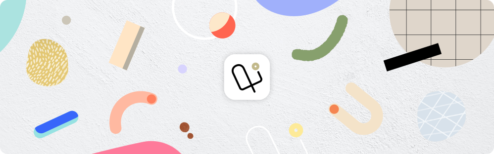
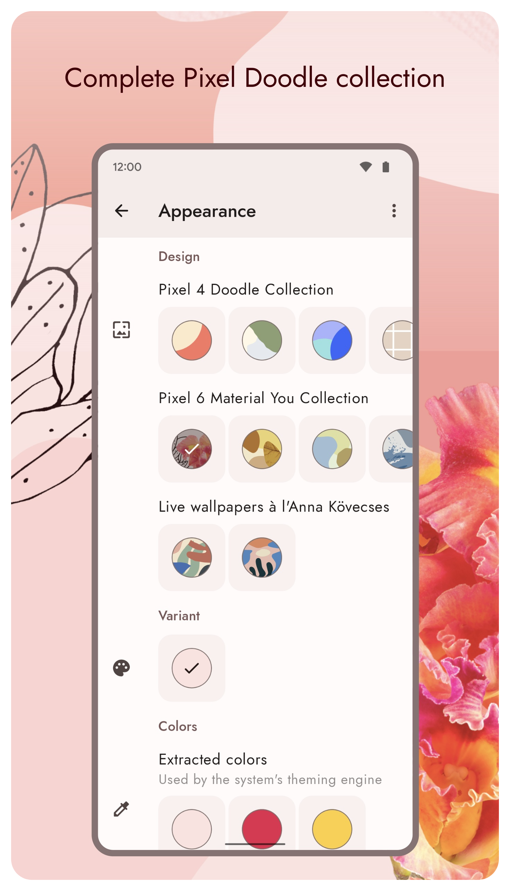
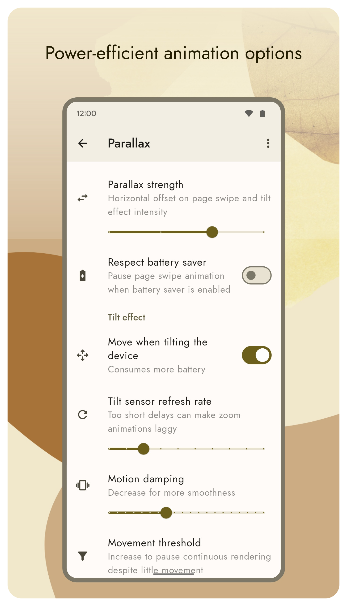
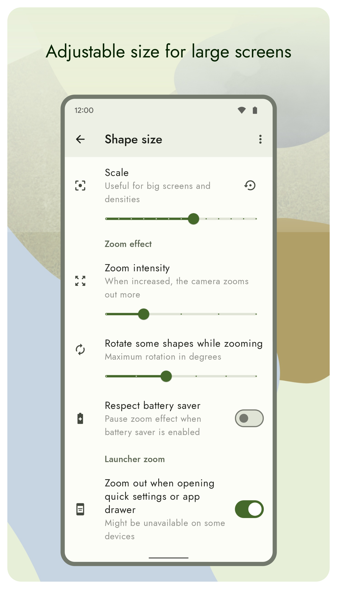
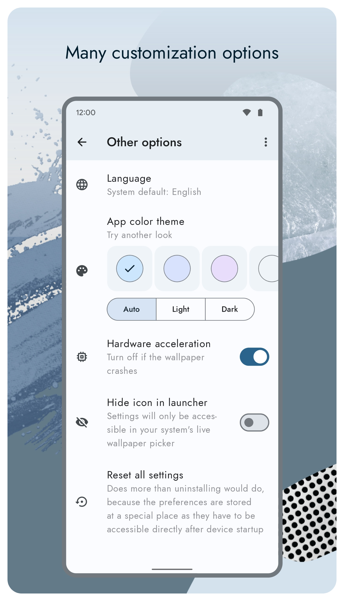

# 🎨 Mural: Live Wallpapers

[](https://www.gnu.org/licenses/gpl-3.0)  [](https://developer.android.com)  [](https://kotlinlang.org)

**Mural** is an open-source Android app that provides colorful live wallpapers with auto dark mode and power-efficient animations.

The wallpapers are based on the original Doodle (now Mural) live wallpaper collection of the Google Pixel 4 and the leaked (but never officially released) Material You static wallpaper collection of the Pixel 6, extended with additional wallpapers from Chrome OS.
The app is not just a copy of the original wallpapers, it's a complete rewrite without the permanent animations to save battery and storage space. In addition, there are many customization options to match your preferences.

> 🙏 **Attribution:** Mural is a GPL-3 redistribution of the fantastic [Doodle Android](https://github.com/patzly/doodle-android) project by Patrick Zedler (@patzly).

## 📱 Screenshots

<p align="center">
  &nbsp;
  &nbsp;
  &nbsp;
  
</p>

## ✨ Features

* Stunning wallpaper designs and Pixel feeling
* System dependent dark mode
* Power-efficient parallax effect on page swipe or when tilting the device
* Optional zoom effects
* Direct boot support (immediately active after device restart)
* Material You color extraction
* No ads and no analytics

## 💪 Advantages over original Pixel 4 live wallpapers

* Permanent animations (when tilting the device) are optional
* Support for Material You color extraction
* No battery-hungry 3D engine
* Improved text contrast (dark text for light themes instead of white text with shadow)
* Many additional customization options
* Rendering works well even on less powerful devices (very efficient rendering engine)
* Also suitable for larger devices like tablets (scaling option available)
* Tiny installation size

## 📦 Build from Source

```bash
git clone https://github.com/awaisdev5765/mural.git
cd mural
./gradlew assembleDebug
```

Requires **Android Studio** with the Android SDK. The app requires at least Android 5.0 Lollipop and works properly on devices without any Google service installed.

### Install on a device

```bash
adb install app/build/outputs/apk/debug/app-debug.apk
```

## 🤝 Contributing

If you run into a bug or miss a feature, please [open an issue](https://github.com/awaisdev5765/mural/issues) in this repository.

## ☕ Support

If this project helps you, please consider supporting my work:

<p align="center">
  <a href="https://buymeacoffee.com/awaisdev572">
    
  </a>
</p>

Or [become a supporter on Buy Me a Coffee](https://buymeacoffee.com/awaisdev572) 💛

## 📄 License

Copyright © 2019-2025 Patrick Zedler. All rights reserved.

[GNU General Public License version 3](https://www.gnu.org/licenses/gpl.txt)

> Mural is free software: you can redistribute it and/or modify it under the terms of the GNU General Public License as published by the Free Software Foundation, either version 3 of the License, or (at your option) any later version.
>
> Mural is distributed in the hope that it will be useful, but WITHOUT ANY WARRANTY; without even the implied warranty of MERCHANTABILITY or FITNESS FOR A PARTICULAR PURPOSE. See the GNU General Public License for more details.
